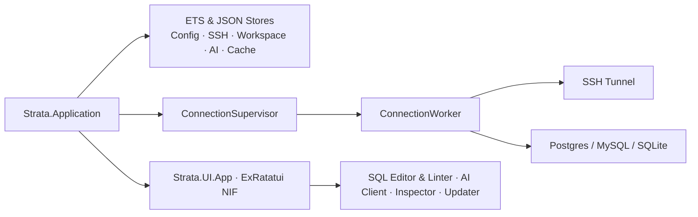

# strata — Modern Terminal Database Manager

[](https://github.com/quaywin/strata/actions/workflows/ci.yml)
[](https://github.com/quaywin/strata/actions/workflows/release.yml)
[-purple.svg)](https://elixir-lang.org/)
[](#license)

**`strata`** is a standalone, keyboard-first **Database TUI Manager** built on **Elixir/OTP** and **ExRatatui** (Rust Ratatui NIF). It brings multi-engine database management, SSH tunneling, a tabbed SQL workspace with real-time linting & local AI assistance, and a dual-mode data grid with staged inline editing into a single binary.

## ✨ Features

- **Multi-Engine & SSH**: Native **PostgreSQL**, **MySQL / MariaDB**, and **SQLite** support with auto-connect profiles, `~/.ssh/config` discovery, inline manual SSH tunneling (Erlang `:ssh`), and unified connection testing.
- **Dual-Mode Data Grid & Staged Editing**: Switch between clean **Browsing Mode** and cell-level **Select Mode** for inline editing, `NULL` assignment, row insert/delete staging, confirmation before commit, and instant revert.
- **Filter, Sort, Structure & Export**: Interactive `Column / Operator / Value / Sort` filter bar, quick filter-by-cell, table structure view, and export to **CSV**, **JSON**, or **SQL `INSERT`**.
- **Tabbed SQL Editor**: Persistent multi-tab workspace with context-aware autocompletion (keywords, tables, columns) and pure-Elixir real-time linting (syntax balance, schema column checks, missing `WHERE` warnings).
- **Local AI SQL Assistant**: Integrates with installed `claude`, `codex`, or `agy` CLIs in a right-hand chat drawer with schema-aware context, per-tab conversation history, and re-applicable SQL turns.
- **Live Inspector & Universal Copy**: Right-hand Inspector drawer with JSON pretty-printing, 16-byte UUID decoding, and Hex/ASCII binary dumps, plus shift-free drag-to-select clipboard copy (OS clipboard + **OSC 52** for SSH/`tmux`).
- **Standalone & Self-Updating**: Packaged with **Burrito** (no Erlang/Elixir runtime required) with built-in GitHub Releases self-update (`strata update`).

## 🏗️ Architecture



## 🚀 Installation

### Quick Install (Prebuilt Binary)

Prebuilt standalone binaries are published for **`macos_aarch64`** (Apple Silicon) and **`linux_x86_64`**:

```bash
curl -fsSL https://raw.githubusercontent.com/quaywin/strata/main/install.sh | sh

# Or pin a specific release tag:
# VERSION=v0.1.06 sh -c "$(curl -fsSL https://raw.githubusercontent.com/quaywin/strata/main/install.sh)"
```

### From Source & Release Builds

Requires **Elixir `~> 1.18`** and **Erlang/OTP 28+** (toolchain pinned in [`mise.toml`](mise.toml): Elixir `1.20.4`, OTP `28.5.0.7`, Zig `0.15.2`, Rust `1.91.0`):

```bash
git clone https://github.com/quaywin/strata.git && cd strata
mise install          # optional: install pinned toolchain
mix deps.get && mix compile
mix strata            # run TUI in development
mix test              # run test suite
```

Build a standalone binary into `burrito_out/` (requires Zig `0.15.2`, Rust, `xz`, `7z`):

```bash
MIX_ENV=prod mix release --overwrite

# Cross-compile Linux x86_64 musl:
TARGET_ARCH=x86_64 TARGET_OS=linux TARGET_ABI=musl BURRITO_TARGET=linux_x86_64 MIX_ENV=prod mix release --overwrite
```

## 🛠️ CLI & Updates

```bash
strata                           # Launch interactive TUI
strata --help                    # Show CLI help (-h)
strata --version                 # Print version (-v)
strata update --check            # Check for newer GitHub releases (--check-update)
strata update                    # Self-update standalone binary (--update)
strata update --version v0.1.10  # Update to a specific tag
```

In-app updates are also available under **Actions** (`?` or `Ctrl+P`) → **Check for Updates**.

## ⌨️ Keybindings

### Global & Workspace

| Key | Action |
| :--- | :--- |
| `1` / `2` / `3` (`Ctrl+1/2/3`, `F1/F2`) | Switch to **Table View** / **SQL View** / **Data Grid** |
| `Tab` / `Shift+Tab` | Cycle focus (`Sidebar` ↔ `Editor` ↔ `AI Panel` ↔ `Data Grid`) |
| `Ctrl+T` / `Ctrl+W` / `Ctrl+←` `→` | New / Close / Switch tabs |
| `Ctrl+O` / `F6` | Toggle / focus **AI SQL Assistant** |
| `F3` / `F4` | Toggle **Table Structure** / **Right Inspector** |
| `?` / `Ctrl+P` | Open contextual **Actions Menu** |
| `q` | Quit (outside Editor / AI Panel, with no modal open) |

### Sidebar, SQL Editor & AI Panel

| Scope | Key | Action |
| :--- | :--- | :--- |
| **Sidebar** | `↑↓←→` / `Enter` / `/` | Navigate tree / Open table / Filter tree |
| **Sidebar** | `r` (`F5`) / `u` / `c` / `o` | Connect & refresh / Disconnect / Collapse all / Expand all |
| **Sidebar** | `a` / `e` / `d` | Add / Edit / Delete connection |
| **SQL Editor** | `Ctrl+Enter` (`Ctrl+R`) / `Ctrl+K` | Execute query / Clear editor |
| **SQL Editor** | `Ctrl+Space` / `Tab` or `Enter` | Trigger / Accept autocomplete (`Esc` dismiss or focus grid) |
| **AI Panel** | `Enter` / `Shift+Enter` (`Ctrl+J`) | Send prompt / Insert newline |
| **AI Panel** | `↑` / `Enter` (in history) / `Ctrl+L` | Browse turns / Apply turn SQL / Reset conversation (`Esc` back) |

### Data Grid & Inspector

| Key | Action |
| :--- | :--- |
| `v` / `Enter` / `Space` | Enter **Select Mode** (`Esc` or `v` returns to Browsing) |
| `↑↓←→` / `hjkl` / `g` `G` / `PgUp` `PgDn` | Navigate or scroll (`s` toggles Structure, `Ctrl+G` opens query in SQL tab) |
| `f` or `/` / `Shift+F` / `Ctrl+L` | Open Filter & Sort bar / Filter by selected cell / Clear filter |
| `o` / `-` | Sort picker or sort active column / Clear sort |
| `e` / `i` / `d` | Inline edit (`Ctrl+N` = `NULL`) / Insert blank row / Mark row for delete |
| `Ctrl+S` / `Ctrl+Z` | Commit / Revert staged changes |
| `c` (`y`) / `Y` / `E` | Copy cell / Copy row (TSV) / Export (`CSV`, `JSON`, `SQL`) |
| `Enter` (Select) / `I` (`F4`) | Open / Toggle **Inspector** (`[`/`]` & `{`/`}` scroll, `m` cycle format) |

**Mouse**: Click to focus, switch tabs, or load tables; double-click a grid cell to inspect it; scroll independently per pane; click-and-drag anywhere (without `Shift`) to copy screen text; click outside modals to dismiss.

## 📁 Storage & Environment

All local state is stored under `~/.strata/` (`0600` permissions on ETS files) with JSON profile backup at `~/.config/strata/profiles.json`:

- `config.db` / `ssh_profiles.db` — database & SSH profiles (override via `STRATA_CONFIG_PATH`, `STRATA_SSH_DB_PATH`)
- `ai_settings.json` / `workspace.json` — AI CLI settings & saved tabs/conversations (override via `STRATA_AI_SETTINGS_PATH`, `STRATA_WORKSPACE_PATH`)
- `strata.log` — runtime logs

Additional env flags: `STRATA_TUI=false` (disable TUI) and `STRATA_KEYBOARD_ENHANCEMENT=true` (enable Kitty keyboard protocol; off by default so macOS IMEs work cleanly).

## 📄 License

Distributed under the **MIT License**.
